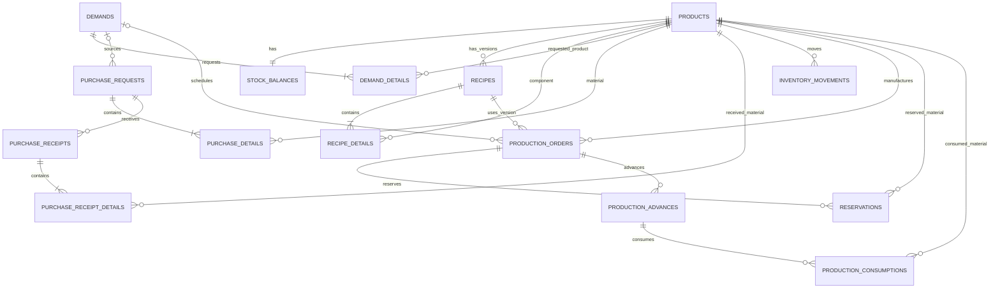

# SYNTHEX — Modelo de datos y relaciones

**Versión:** 1.2  
**Fecha:** 12 de noviembre de 2026  
**Motor:** SQLite  

## 1. Criterios del modelo

- El catálogo `products` concentra componentes y productos terminados. El campo `product_type` distingue su uso.
- `stock_balances` guarda el saldo físico; las reservas se guardan aparte.
- Una receta se versiona en `recipes`; sus componentes y cantidades viven en `recipe_details`.
- Las demandas, compras, recepciones y órdenes de producción conservan documentos propios.
- Una demanda puede asociarse a varias órdenes de producción independientes; esta relación DEM 1:N se utiliza en el flujo validado de producción parcial por disponibilidad.
- Los avances y consumos reales se almacenan en tablas separadas para mantener detalle por evento.
- `inventory_movements` conserva un registro de entradas y salidas asociado a un producto y a un documento de referencia.

## 2. Entidades y campos principales

Los campos listados describen el esquema observado en `database.py`. Los tipos se indican de forma funcional; SQLite utiliza afinidad de tipos.

| Tabla | Campos principales | Propósito |
|---|---|---|
| `products` | `id`, `code` (único), `name`, `product_type`, `unit`, `unit_cost`, `active`, `created_at` | Catálogo de productos terminados y componentes. |
| `stock_balances` | `id`, `product_id` (único/FK), `physical_stock` | Saldo físico por producto. |
| `recipes` | `id`, `product_id` (FK), `version`, `name`, `active`, `created_at`, UNIQUE(`product_id`,`version`) | Versiones de receta de un producto terminado. |
| `recipe_details` | `id`, `recipe_id` (FK), `component_id` (FK a products), `quantity` | Componentes por unidad de receta. |
| `demands` | `id`, `code` (único), `description`, `status`, `created_at` | Solicitud de fabricación. |
| `demand_details` | `id`, `demand_id` (FK), `product_id` (FK), `quantity` | Productos y cantidades solicitadas en una demanda. |
| `purchase_requests` | `id`, `code` (único), `demand_id` (FK opcional), `status`, `created_at` | Solicitud de compra. |
| `purchase_details` | `id`, `purchase_id` (FK), `product_id` (FK), `quantity`, `unit_cost` | Líneas de materiales solicitadas. |
| `purchase_receipts` | `id`, `code` (único), `purchase_id` (FK), `received_at` | Evento de recepción asociado a una solicitud. |
| `purchase_receipt_details` | `id`, `receipt_id` (FK), `product_id` (FK), `quantity`, `unit_cost` | Material y cantidad recibidos en cada recepción. |
| `inventory_movements` | `id`, `product_id` (FK), `movement_type`, `quantity`, `reference`, `unit_cost`, `created_at` | Entradas y salidas de inventario. |
| `production_orders` | `id`, `code` (único), `demand_id` (FK opcional), `product_id` (FK), `recipe_id` (FK), `planned_quantity`, `estimated_unit_material_cost`, `produced_quantity`, `status`, `created_at`, `released_at`, `completed_at`, `cancelled_at` | Orden de producción y sus estados/fechas. |
| `reservations` | `id`, `production_order_id` (FK), `product_id` (FK), `quantity`, `consumed_quantity`, `status` | Material comprometido por orden. |
| `production_advances` | `id`, `code` (único), `production_order_id` (FK), `produced_quantity`, `notes`, `created_at` | Avance parcial o total de una orden. |
| `production_consumptions` | `id`, `advance_id` (FK), `product_id` (FK), `quantity`, `unit_cost` | Consumo real por material y avance. |

## 3. Relaciones principales

| Relación | Cardinalidad | Explicación |
|---|---|---|
| `products` → `stock_balances` | 1 a 1 | Un producto tiene un registro de saldo físico. `stock_balances.product_id` es único. |
| `products` → `recipes` | 1 a N | Un producto terminado puede tener varias versiones de receta. |
| `recipes` → `recipe_details` | 1 a N | Una versión incluye varios componentes. |
| `products` → `recipe_details` | 1 a N | Un producto tipo Componente puede aparecer en varias recetas. |
| `demands` → `demand_details` | 1 a N | Una demanda puede solicitar uno o varios productos. |
| `products` → `demand_details` | 1 a N | Un producto puede aparecer en distintas demandas. |
| `demands` → `purchase_requests` | 1 a N | Una demanda puede generar solicitudes de compra. La asociación es opcional. |
| `purchase_requests` → `purchase_details` | 1 a N | Una solicitud contiene líneas de materiales. |
| `purchase_requests` → `purchase_receipts` | 1 a N | Una solicitud puede recibirse en varios eventos parciales. |
| `purchase_receipts` → `purchase_receipt_details` | 1 a N | Una recepción registra una o varias líneas recibidas. |
| `products` → `inventory_movements` | 1 a N | Cada movimiento pertenece a un producto. |
| `demands` → `production_orders` | 1 a N | Una demanda puede cubrirse con varias órdenes parciales. La asociación es opcional. |
| `products` → `production_orders` | 1 a N | Cada orden fabrica un producto terminado. |
| `recipes` → `production_orders` | 1 a N | Cada orden conserva la versión de receta usada. |
| `production_orders` → `reservations` | 1 a N | Una orden reserva varios componentes. |
| `production_orders` → `production_advances` | 1 a N | Una orden puede tener varios avances. |
| `production_advances` → `production_consumptions` | 1 a N | Un avance puede consumir varios materiales. |

## 4. Reglas de integridad y cálculo

### 4.1. Disponibilidad

`available_stock = physical_stock - reserved_stock`

La reserva activa pendiente de consumo se obtiene considerando `quantity - consumed_quantity` para reservas cuyo estado es Activa.

### 4.2. Costo estimado por unidad

Suma de `recipe_details.quantity × products.unit_cost` para todos los componentes de la versión de receta seleccionada.

### 4.3. Costo real

Suma de `production_consumptions.quantity × production_consumptions.unit_cost` para los consumos asociados a los avances de la orden.

### 4.4. Balance de producción

- Unidades programadas vigentes: suma de `planned_quantity` de órdenes en Borrador o En producción.
- Unidades pendientes vigentes: suma de `planned_quantity - produced_quantity` de órdenes en Borrador o En producción.
- Unidades producidas históricas: suma de `produced_quantity` reportada por las órdenes.
- Total de órdenes: conteo de todos los documentos, incluidas las anuladas.

## 5. Diagrama entidad-relación (Mermaid)

El archivo editable se encuentra en `08_diagrama_entidad_relacion.mmd`.

## 6. Producción parcial por demanda y conciliación de materiales

El modelo soporta varias filas en `production_orders` asociadas al mismo `demand_id`. El flujo validado usa OP independientes: cada documento conserva su cantidad planeada, receta, reservas, avances y estado. No se agrega `released_quantity` ni se modifica la cantidad planeada de una OP después de creada.

El cálculo de capacidad de producción considera el stock físico, las reservas activas no consumidas y los compromisos de órdenes en Borrador. La demanda muestra el saldo pendiente por programar y permite generar una nueva OP dentro de ese saldo.

La consulta de materiales de una demanda presenta:

- `required_quantity`: necesidad total de componentes según la cantidad demandada y la receta activa consultada.
- `initial_stock`: stock inicial reconstruido a partir del stock físico actual y el neto de movimientos posteriores a la creación de la demanda.
- `received_quantity`: suma de recepciones registradas en solicitudes asociadas a la demanda.
- `consumed_quantity`: suma de los consumos reales registrados en avances de órdenes asociadas a la demanda.
- `physical_stock`: existencia física actual en `stock_balances`.
- `shortage`: faltante que sigue sin cubrirse con los materiales disponibles para la demanda, después de considerar consumo, reservas/compromisos de otras órdenes y stock actual.

La reconstrucción de `initial_stock` depende de que los movimientos posteriores estén registrados en `inventory_movements`. Cambios de stock no registrados como movimientos pueden afectar el valor histórico reconstruido. No se añadió una nueva tabla o columna para esta funcionalidad; se reutilizan las relaciones y movimientos existentes.

## 7. Límites del esquema actual

- No hay tabla `users` ni columnas `user_id` en movimientos, compras o producción.
- No hay tabla de auditoría de cambios.
- El costo se limita a materiales directos.
- No existen tablas de pronóstico, inventario de seguridad ni parámetros DOH en el MVP.
- Los movimientos guardan tipo, cantidad, referencia, costo unitario y fecha; el usuario real que ejecutó el movimiento no queda registrado.
- El stock inicial presentado en la ficha de materiales de una demanda es reconstruido por movimientos; no es una instantánea histórica persistida en una tabla independiente.
